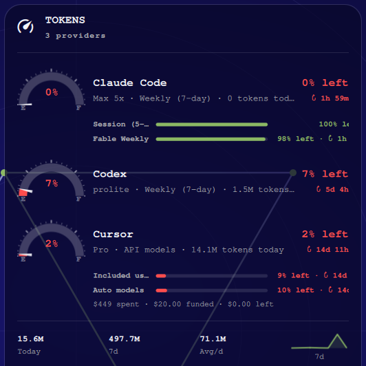

# wszaq.token-gauge

Omarchy bar widget (and optional desktop card) that shows AI agent token
**remaining** as JustGage-style fuel-tank dials, plus a shared
Today / 7d / Avg/d footer.



## Pages

- [Install](Install.md)
- [Controls](Controls.md)
- [Data](Data.md)
- [Screenshots](Screenshots.md)
- [Troubleshooting](Troubleshooting.md)

## Quick install

```bash
omarchy plugin add https://github.com/wszaq/omarchy-token-gauge.git --enable
omarchy bar move wszaq.token-gauge --section right
omarchy plugin disable omarchy.agents
```

Plugin id: `wszaq.token-gauge` · Author: **wszaq** · License: MIT

Repo: https://github.com/wszaq/omarchy-token-gauge
