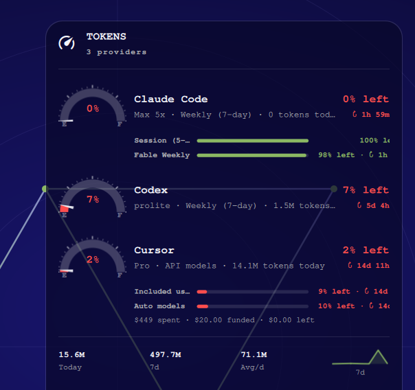

# Screenshots

## Panel / desktop card


Same content is used for the bar popup and the 2×2 Widgets card.

## Desktop context



## Re-capture

On an unlocked Omarchy desktop with the card or popup visible:

```bash
./scripts/capture-screenshots.sh
```
